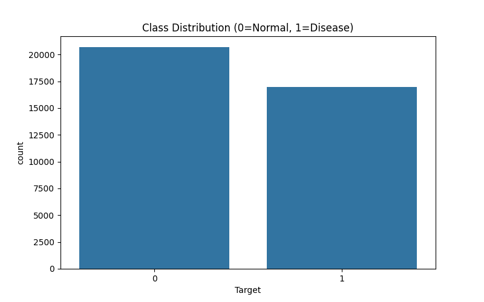
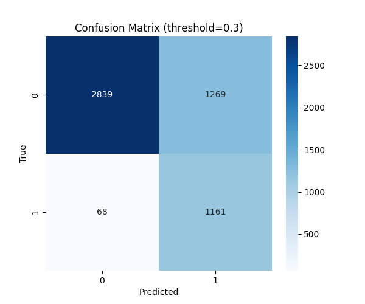
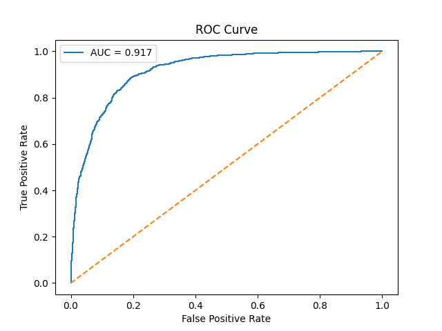

# Pneumonia Detection from Chest X-rays

This project trains a binary image classifier to identify pneumonia in chest
X-rays. It uses a ResNet-50 backbone with a squeeze-and-excitation attention
block and evaluates predictions with ROC-AUC, precision, recall, F1-score, and
a confusion matrix.

> **Research/education use only.** This project is not a medical device and
> must not be used to diagnose, treat, or make decisions about patients.

## Repository contents

```text
.
├── DL CCP.pdf                 # Project report
├── outputs/                   # Example analysis and evaluation plots
├── scripts/
│   ├── 1_preprocess.py        # Convert DICOM images to PNG
│   ├── 2_profiling.py         # Inspect labels and plot class distribution
│   ├── dataset.py             # PyTorch dataset and image transforms
│   ├── evaluate.py            # Evaluate a saved model and plot results
│   ├── model.py               # ResNet-50 + SE model
│   └── train.py               # Model training
├── .gitignore
└── requirements.txt
```

The dataset and generated PNG images are not included. The `.gitignore` also
excludes trained model checkpoints.

## Dataset

Download the RSNA Pneumonia Detection Challenge data from
[Kaggle](https://www.kaggle.com/c/rsna-pneumonia-detection-challenge) and
organize the files as follows:

```text
data/
├── stage_1_train_labels.csv
├── stage_1_detailed_class_info.csv
└── stage_1_train_images/
    └── stage_2_train_images/
        ├── <patientId>.dcm
        └── ...
```

The dataset is subject to its source's terms and conditions. Obtain it directly
from Kaggle; do not commit the data or converted images to this repository.

## Setup

Use Python 3.10 or later. A CUDA-capable NVIDIA GPU is required by the current
training and evaluation scripts, which call `.cuda()` directly.

Create and activate a virtual environment from the repository root:

```powershell
py -3 -m venv .venv
.\.venv\Scripts\Activate.ps1
```

Install PyTorch and Torchvision using the
[official PyTorch installation selector](https://pytorch.org/get-started/locally/)
to match your CUDA setup. Then install the remaining project dependencies:

```powershell
python -m pip install -r requirements.txt
```

The model uses ImageNet-pretrained ResNet-50 weights, which Torchvision may
download the first time the model is initialized.

## Run

The scripts use paths relative to their current working directory. Run them
from the `scripts` directory:

```powershell
cd scripts
python 1_preprocess.py
python 2_profiling.py
python train.py
python evaluate.py
```

Run preprocessing before training so that the PNG images exist. Training saves
the best checkpoint to `outputs/best_model.pth`; evaluation loads that
checkpoint and saves `outputs/confusion_matrix.png` and
`outputs/roc_curve.png`. The profiling script writes
`outputs/class_distribution.png`.

## Model and evaluation notes

- DICOM images are scaled to 8-bit PNG during preprocessing.
- Images are resized to 512 × 512 and normalized using ImageNet statistics.
- Training uses augmentation, focal loss with label smoothing, and a
  patient-grouped stratified split. The current script trains on the first
  split yielded by a five-fold splitter; it does not train five separate
  models.
- Evaluation currently samples a random 20% of the labeled dataset. This is
  not an independent test set and may overlap the data used for training, so
  its metrics should be treated as exploratory rather than as an unbiased
  estimate of generalization performance.
- The evaluation threshold is set to 0.3 in the script. It is an experimental
  setting, not a clinically validated threshold.

  ## Example outputs

  These plots are included in `outputs/` as project artifacts:

  | Class distribution | Confusion matrix | ROC curve |
  |---|---|---|
  |  |  |  |

  ## License

  No license is currently specified. Add a license before redistributing this
  project or accepting external contributions.
